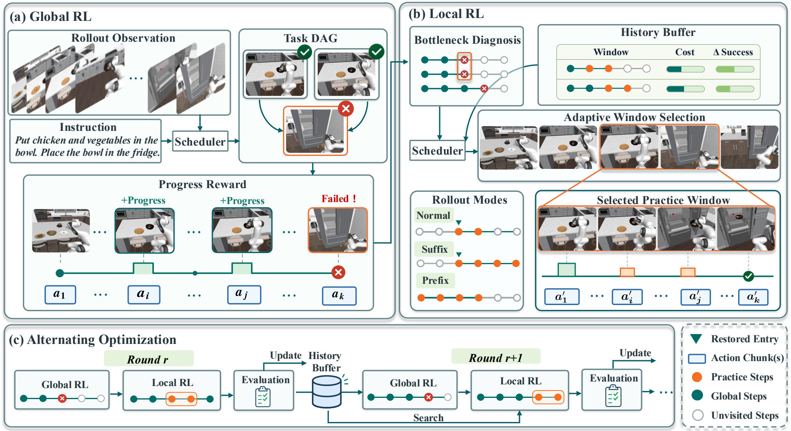

# ReFocus

**Progress-Guided Adaptive Practice for Long-Horizon Robotic Manipulation Reinforcement Learning**

[Project website source](https://github.com/ReFocus-Robotics/refocus.github.io) ·
[Method notes](docs/REFOCUS.md) ·
[StructRL baselines](docs/REPRODUCE.md)

  

## 📚 Contents

- [✨ Overview](#overview)
- [⚙️ Environment setup](#environment-setup)
- [🏋️ Training](#training)
- [🧪 Local checks](#local-checks)
- [📁 Repository structure](#repository-structure)
- [📄 Attribution and license](#attribution-and-license)

## ✨ Overview

ReFocus alternates Global and Local PPO on a shared π0.5 policy. Global PPO rewards verified subtask completions with a stage-balanced budget. A visual Scheduler uses validation rollouts and practice history to select bottleneck windows. Local PPO concentrates interaction on those windows through normal-start and snapshot-restored rollouts.

This release contains the simulation training code and launch scripts for **RoboCasa365 Composite-Seen**. Training starts from a compatible π0.5 PyTorch SFT checkpoint supplied by the user.

## ⚙️ Environment setup

The training recipe uses two Linux x86-64 nodes with eight NVIDIA GPUs each. Set up the same Python 3.11 Conda environment on both nodes.

~~~bash
git clone https://github.com/ReFocus-Robotics/ReFocus.git
cd ReFocus
conda create -n refocus --override-channels -c conda-forge python=3.11 pip ffmpeg=7
conda activate refocus
~~~

Follow the [RoboCasa365 installation steps](docs/INSTALL.md#refocus-on-robocasa365) to install the pinned training stack and download simulator assets. Make the checkout, run directory, and SFT checkpoint available at the same absolute paths on both nodes.

## 🏋️ Training

### 1. Configure both Ray nodes

Activate the environment and run these commands from the repository root on each node. Replace the checkpoint and head IP with your own values.

~~~bash
conda activate refocus
export VENV="$CONDA_PREFIX"
export PI05_SFT_CKPT=/path/to/composite-seen-pytorch-checkpoint
export RAY_HEAD_IP=10.0.0.10
source examples/robocasa365/rlinf/rsi_env.sh
export RAY_ADDRESS="$RAY_HEAD_IP:$RAY_PORT"
~~~

### 2. Install the hooks and start Ray

Install the hooks once in the shared RLinf checkout, before starting Ray.

~~~bash
python scripts/install_rsi_hooks.py "$RLINF_ROOT"
~~~

Run `bash examples/robocasa365/rlinf/ray_head_8gpu.sh` on the head node and
`bash examples/robocasa365/rlinf/ray_worker_8gpu.sh` on the worker node.

### 3. Launch ReFocus on the head node

Set `ADVISOR_API_KEY`, `ADVISOR_BASE_URL`, and `ADVISOR_MODEL` on the head node after Ray starts. The endpoint needs to accept image inputs for the visual Scheduler. See the [Scheduler setup](docs/ADVISOR_COMPARISON.md) for provider-specific settings.

~~~bash
bash scripts/run_robocasa_rsi.sh \
  --rlinf-root "$RLINF_ROOT" --run-root "$STRUCTRL_RSI_ROOT" \
  --advisor-provider openai-compatible \
  --advisor-base-url "$ADVISOR_BASE_URL" --advisor-model "$ADVISOR_MODEL"
~~~

The [training configuration](configs/robocasa365_ppo_openpi_pi05_refocus_16gpu.yaml) uses **256 training environments**, a **global batch of 512**, and a **microbatch of 32 per GPU**. The coordinator runs three rounds of 25 Global and 25 Local PPO updates. At each diagnostic checkpoint, it evaluates five normal-start episodes per task. Outputs are written to `$STRUCTRL_RSI_ROOT`.

## 🧪 Local checks

The CPU test suite and schedule preview run without Ray, simulator assets, or a checkpoint.

~~~bash
conda create -n refocus-test --override-channels -c conda-forge python=3.11 numpy pillow pytest pyyaml
conda activate refocus-test
python -m pytest
python -m structrl.rsi.run --rlinf-root ./RLinf --run-root ./runs/dry-run --dry-run
~~~

## 📁 Repository structure

| Path | Purpose |
| --- | --- |
| [`refocus/`](refocus/) | Stage-balanced progress and milestone rewards |
| [`structrl/rsi/`](structrl/rsi/) | Training coordinator, Scheduler integration, and snapshot restoration |
| [`configs/`](configs/) | Hydra training and simulator configurations |
| [`scripts/`](scripts/) | Upstream setup, hook installation, and training entry points |
| [`examples/robocasa365/`](examples/robocasa365/) | Ray launch scripts and milestone configuration example |

## 📄 Attribution and license

ReFocus builds on [StructRL](https://github.com/amazon-science/StructRL) and [RLinf](https://github.com/RLinf/RLinf). StructRL-derived material is distributed under the upstream [CC BY-NC 4.0 license](LICENSE). See [NOTICE](NOTICE), [third-party licenses](THIRD-PARTY-LICENSES), and [source provenance](SOURCE_SNAPSHOT.md).
